<p align="center">
  
</p>

<h1 align="center">Juntia</h1>

<p align="center">
  <b>The self-hosted portal for a residents' community: transparent shared finances, repairs and improvements, events, neighbors and contacts in one place.</b>
</p>

<p align="center">
  <a href="https://github.com/DrDonoso/juntia/actions/workflows/docker-deploy.yml"></a>
  <a href="LICENSE"></a>
  <a href="https://hub.docker.com/r/drdonoso/juntia"></a>
  <a href="https://hub.docker.com/r/drdonoso/juntia"></a>
</p>

<p align="center">
  <a href="https://demo.juntia.drdonoso.com"><b>Try the live demo →</b> demo.juntia.drdonoso.com</a><br>
  <sub>It runs entirely in your browser with synthetic data for the fictional community "Maple Court". You start signed in as a neighbor;
  the welcome dialog also opens the administration (sign-in <code>demo</code> / <code>demo</code>). Nothing is saved: a reload starts over.</sub>
</p>

<p align="center">
  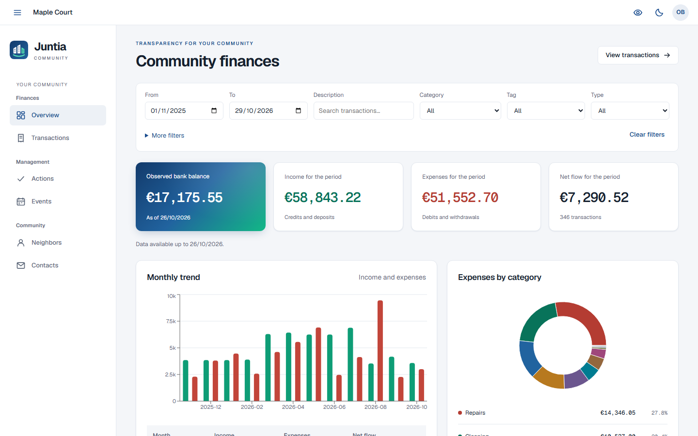
</p>

<p align="center">
  <sub><b>Overview</b>: the community's balance, income, expenses, monthly trend and expenses by category, straight from the imported bank statements.<br>
  <b>All the data in this and every other screenshot is synthetic, taken from the demo: no real community, person or bank account is shown.</b></sub>
</p>

---

## Contents

- [Why Juntia](#why-juntia)
- [Features](#features)
- [Screenshots](#screenshots)
- [How it works](#how-it-works)
- [Deploy with Docker](#deploy-with-docker)
- [Configuration](#configuration)
- [Development](#development)
- [Contributing](#contributing)
- [Security](#security)
- [License](#license)
- [Credits](#credits)

## Why Juntia

I built Juntia for the residents' community where I live, so that every neighbor can see the
community's accounts transparently and we can coordinate repairs, events and useful contacts in one
place. The figures come straight from the bank statements, every repair, event and contact keeps a
history of who changed what, and only invited neighbors can sign in. It is self-hosted, so your
community's data stays on a server you run.

## Features

Juntia serves **one** residential community per installation; [docs/features.md](docs/features.md)
describes every part in detail.

**Finances**

- Bank statement PDFs are read by a deterministic local parser (no AI) that checks every running
  balance; the IBAN is confirmed on the first import and overlapping statements are deduplicated.
- Categories, tags, merchants and prioritized rules, plus optional AI suggestions that the
  administrator reviews before saving.
- An overview with the observed balance, income, expenses, monthly trend, expenses by category and
  top merchants, and a searchable ledger. Residents read; only the administrator writes.

**Management: Actions and Events**

- **Actions** follow repairs and improvements from *Detected* to *Done* in a list or a Kanban board,
  with labels, comments, PDF attachments and a full history with diffs.
- **Events** form a shared agenda, with multi-day and all-day events, links to actions and export to
  Google Calendar or any `.ics` calendar.

**Community: Neighbors and Contacts**

- A private **Neighbors** directory laid out like the building, marking the community president.
- A shared **Contacts** address book for services and useful people, with tags, search and history.

**Administration**

- A separate technical portal at `/admin` for imports, rules, users, dwellings, labels and storage.
- Invitation-only resident accounts with a password or optional Google sign-in, and email
  invitations and password recovery.
- Runtime switches for ownership coefficients, Actions and Events; storage quotas for action PDFs.

**Languages**

- English and Spanish interface, following the browser and switchable from the user menu or the
  sign-in screens. Server texts such as emails follow `APP_LANGUAGE`.

**Security and privacy**

- No public registration; HttpOnly, SameSite Strict cookies; an origin and anti-CSRF check on every
  change; hashed passwords and tokens; throttled sign-in; a strict Content Security Policy.
- A non-root container, an unpublished database and the app port published on `127.0.0.1` by default.
- A **Hide amounts** switch for reading the finances in public. See the
  [security model](docs/security-model.md).

## Screenshots

| Transactions | Reviewing an import |
| :--: | :--: |
| 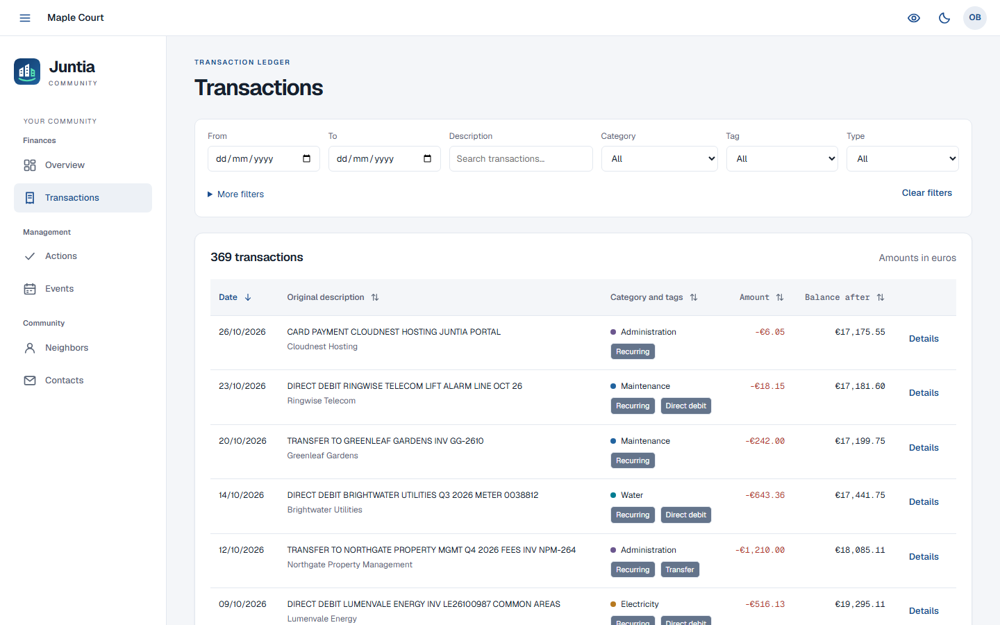 | 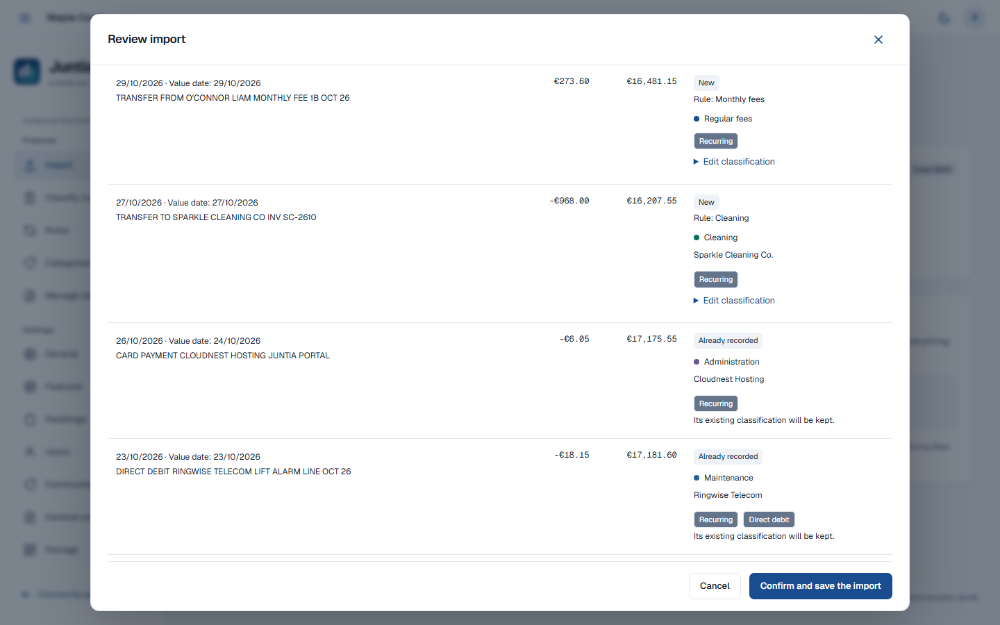 |
| The full ledger with filters by period, category, tag, type and merchant. | Every import is reviewed before saving: new rows, duplicates, rules and suggestions. |

| Actions board | An action |
| :--: | :--: |
| 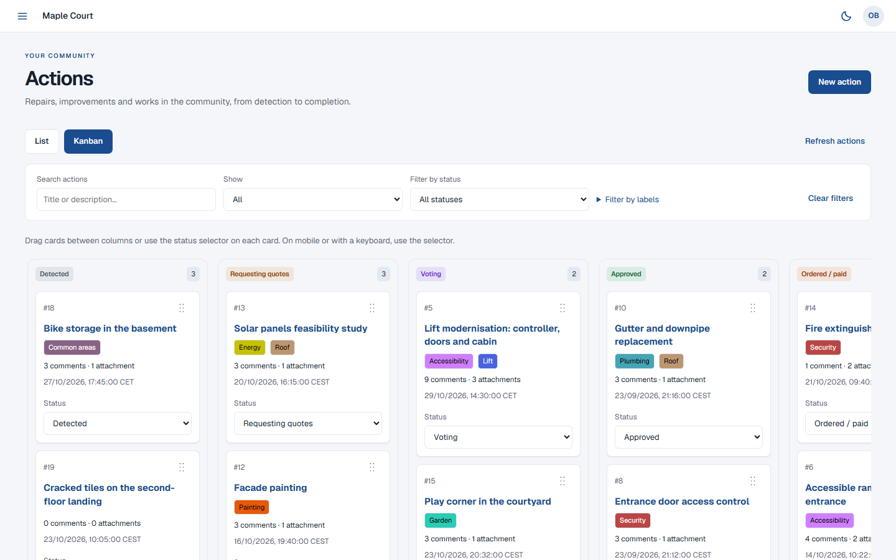 | 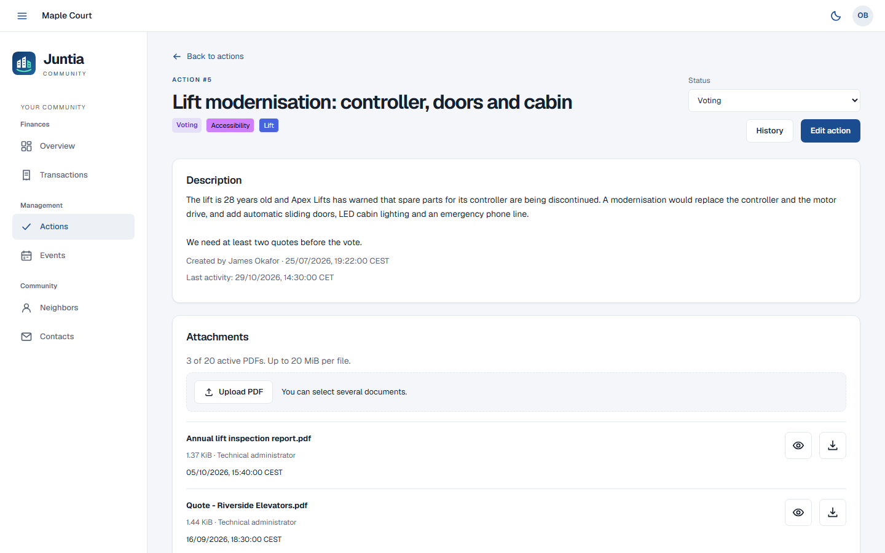 |
| Repairs and improvements on a Kanban board, one column per status. | An action with its status, labels, description and PDF attachments. |

| Events | Neighbors |
| :--: | :--: |
| 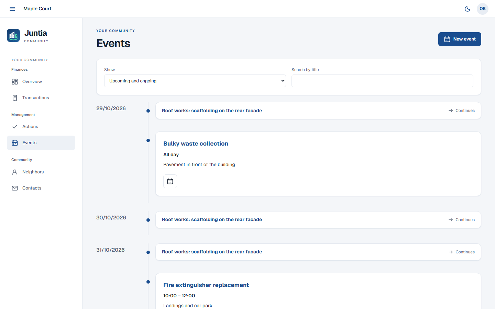 | 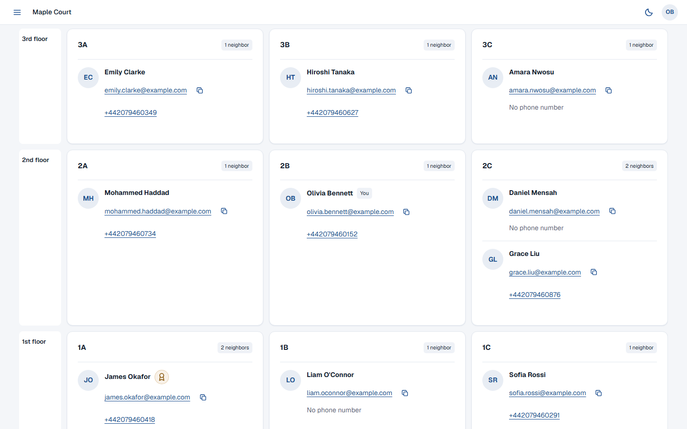 |
| The community agenda, including multi-day and all-day events. | The private directory, arranged like the building. |

| Contacts | Users |
| :--: | :--: |
| 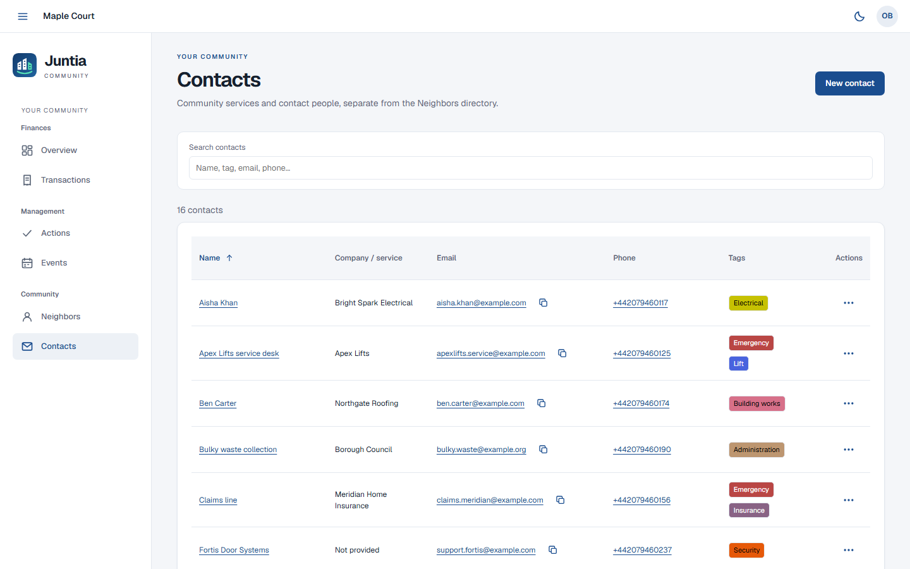 | 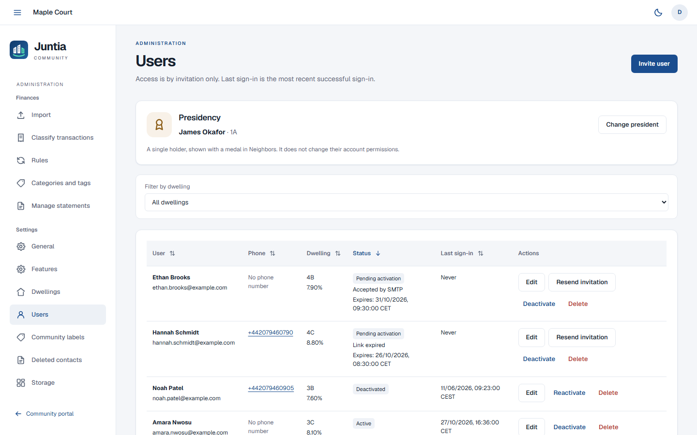 |
| Shared contacts for services and useful people. | Invitations, account status and the presidency, in the administration. |

<p align="center">
  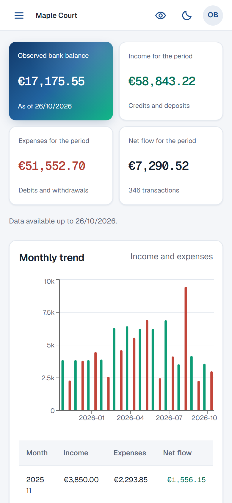<br>
  <sub>The same portal on a phone.</sub>
</p>

> **Every screenshot shows synthetic data from the [demo](https://demo.juntia.drdonoso.com).** More
> screenshots, such as the rules and the storage page, are in [docs/features.md](docs/features.md).

## How it works

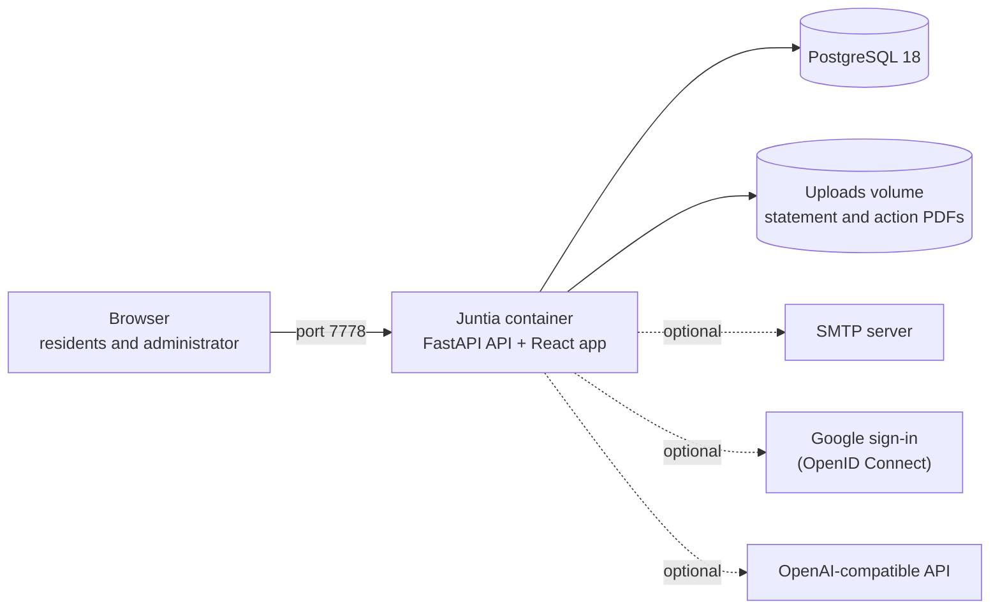

- One image, `drdonoso/juntia`, runs as a non-root user and serves the API and the compiled web app
  on port 7778, next to PostgreSQL. Every start applies the database migrations; the first one also
  creates the default categories, tags and community name in `APP_LANGUAGE`.
- Statements are parsed locally in a time-limited child process. The optional AI receives only
  sanitized transaction descriptions and your category and tag names, never the PDF, IBAN or amounts.
- Stack: Python 3.14, FastAPI, SQLAlchemy, Alembic and PostgreSQL 18; React 19, TypeScript 7, Vite 8,
  TanStack Query and React Aria.

## Deploy with Docker

All you need is [Docker Engine with Docker Compose](https://docs.docker.com/engine/install/) or
[Docker Desktop](https://docs.docker.com/desktop/). Juntia then runs on that machine at
<http://localhost:7778>.

### 1. Download the Compose file

```sh
mkdir juntia && cd juntia
curl -fsSLO https://raw.githubusercontent.com/DrDonoso/juntia/main/docker-compose.yml
curl -fsSL https://raw.githubusercontent.com/DrDonoso/juntia/main/.env.example -o .env
chmod 600 .env
```

### 2. Generate the secrets

Juntia needs two long random secrets, different from each other: `POSTGRES_PASSWORD` for the
database and `AUTH_SECRET`, which signs sessions and account links. This one-line command prints
one; run it once for each:

```sh
openssl rand -hex 32
```

Without OpenSSL, `python3 -c "import secrets; print(secrets.token_hex(32))"` does the same.

### 3. Edit `.env`

Paste the two secrets and choose the administrator's username and password:

```dotenv
POSTGRES_PASSWORD=<first generated value>
AUTH_SECRET=<second generated value>
ADMIN_USERNAME=<administrator username>
ADMIN_PASSWORD=<at least 15 characters>
```

Everything else already works for `http://localhost:7778`. Optionally, set `APP_LANGUAGE=es` for
Spanish emails and default categories (the web interface follows each browser's language) and `TZ`
to the community's time zone.

### 4. Start Juntia

```sh
docker compose up -d
docker compose ps    # wait until the api service is healthy
```

Open <http://localhost:7778/admin> and sign in with your `ADMIN_USERNAME` and `ADMIN_PASSWORD`. To
open Juntia from other devices or from the Internet, follow the
[deployment guide](docs/deployment.md).

### First steps

1. The administration lives at `/admin` and is not linked from the residents' pages. In
   **Settings > General**, set the community name. In **Settings > Dwellings**, create the dwellings
   and, with **Arrange dwellings**, lay them out like the building.
2. In **Settings > Users**, invite the residents. Invitations are sent by email, so they need SMTP
   and an address residents can open (see the [deployment guide](docs/deployment.md)); each link is
   valid for 72 hours.
3. In **Finances > Import**, upload a statement PDF, confirm the IBAN on the first import, review and
   save. Optionally, turn on **Events** in **Settings > Features**.

### Updating and backups

Pin `IMAGE_TAG` in `.env` to a [release](https://github.com/DrDonoso/juntia/releases) (CalVer tags
such as `20261029`), back up, then run `docker compose pull && docker compose up -d`. Migrations run
automatically and an older image cannot undo them, so keep the backup until the new version works
([updating and rolling back](docs/deployment.md#updating)).

Back up the database and the uploads volume (statement originals and action PDFs) together, keep the
copies encrypted and never commit them ([restore](docs/deployment.md#backup-and-restore)):

```sh
umask 077 && mkdir -p backup
docker compose stop api
docker compose exec -T db pg_dump -U juntia -d juntia -Fc > backup/database.dump
docker compose cp api:/app/data/uploads backup/uploads
docker compose start api
```

## Configuration

The most important settings, with the values `.env.example` sets;
[docs/configuration.md](docs/configuration.md) documents all of them, with their validation rules.
After changing `.env`, run `docker compose up -d` to recreate the container (a plain restart keeps
the old values).

| Variable | Default | Purpose |
| --- | --- | --- |
| `POSTGRES_PASSWORD` | required | Database password (only initializes a new database). |
| `AUTH_SECRET` | required | Secret for sessions and account links, at least 32 characters. |
| `ADMIN_USERNAME`, `ADMIN_PASSWORD` | required | Technical administrator; password of 15+ characters, at most 72 bytes. |
| `PUBLIC_ORIGIN` | `http://localhost:7778` | The exact address residents open in the browser (comma-separated for several). |
| `AUTH_COOKIE_SECURE` | `false` | Secure session cookies: `false` for `http://localhost`, `true` when every address uses HTTPS. |
| `APP_LANGUAGE` | `en` | Language of emails, first-run defaults and server labels: `en` or `es`. |
| `APP_BIND_ADDRESS` | `127.0.0.1` | Host address the app port is published on (`127.0.0.1`: this machine only). |
| `APP_PORT` | `7778` | Host port; the container always listens on 7778. |
| `IMAGE_TAG` | `latest` | Image tag to run; pin a CalVer release. |
| `TZ` | `Europe/Madrid` | Community time zone for events. |
| `ACTION_STORAGE_USER_QUOTA_MB`, `ACTION_STORAGE_COMMUNITY_QUOTA_MB`, `MIN_FREE_DISK_MB` | `250`, `2048`, `1024` | Action PDF storage per resident and for the community, and free space to keep on the uploads volume, in MiB. |
| `SMTP_HOST`, `SMTP_FROM`, … | empty | Email for invitations and password recovery. |
| `GOOGLE_CLIENT_ID`, `GOOGLE_CLIENT_SECRET` | empty | Optional Google sign-in. |
| `OPENAI_API_KEY`, `OPENAI_MODEL`, `OPENAI_BASE_URL` | empty | Optional AI classification. |

## Development

Start with [CONTRIBUTING.md](CONTRIBUTING.md); [docs/development.md](docs/development.md) covers the
toolchain, test suites, CI and releases, and [docs/demo.md](docs/demo.md) the static demo.

## Contributing

Bug reports, fixes, translations and ideas are welcome. Read [CONTRIBUTING.md](CONTRIBUTING.md) and
the [Code of Conduct](CODE_OF_CONDUCT.md), then
[open an issue](https://github.com/DrDonoso/juntia/issues/new/choose) or a pull request. Use synthetic
data only: never post real statements, names, addresses or bank details.

## Security

Please report vulnerabilities privately, as described in the [security policy](SECURITY.md), never in
a public issue. The [security model](docs/security-model.md) explains how Juntia protects the
community's data and what every deployment must get right.

## License

[MIT](LICENSE) © 2026 DrDonoso.

## Credits

[Geist](https://vercel.com/font) fonts, under the SIL Open Font License
([`frontend/public/fonts/LICENSE.txt`](frontend/public/fonts/LICENSE.txt)).
