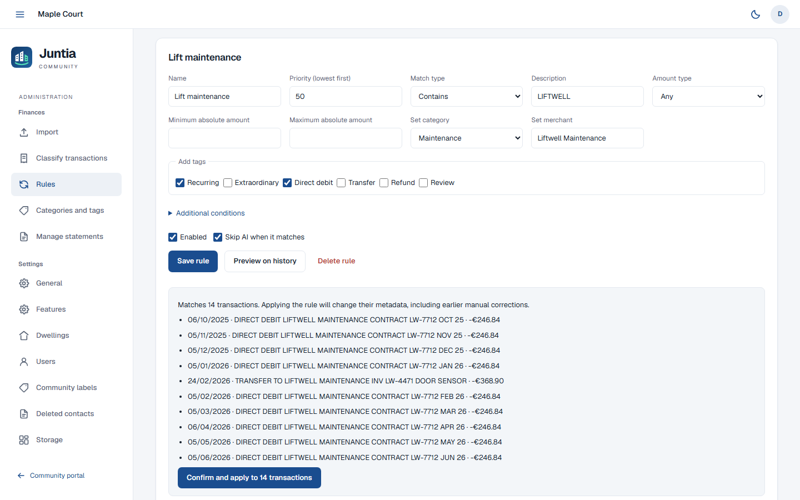
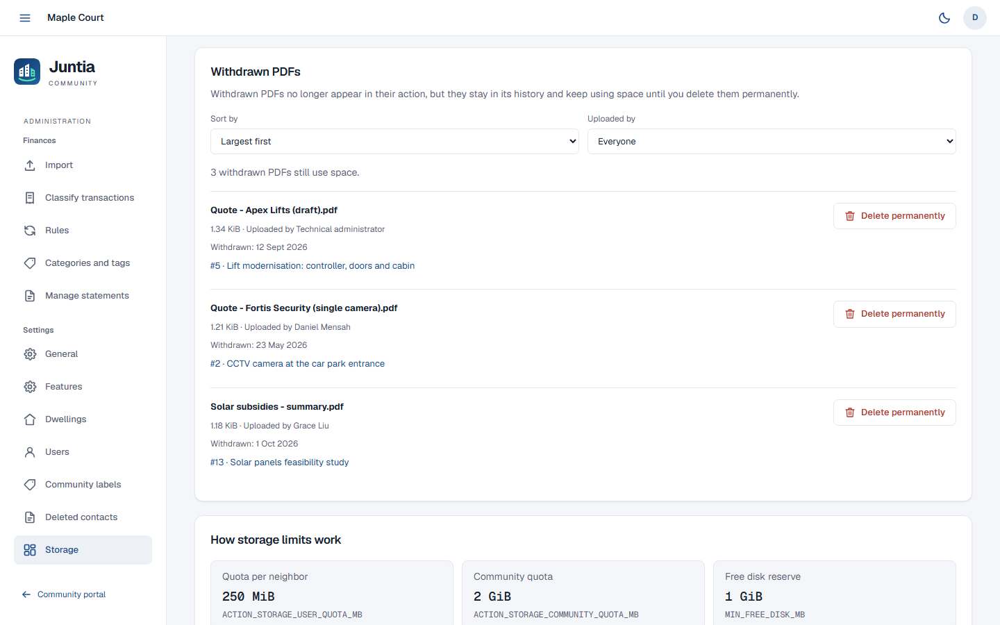

# Features

Juntia is a private portal for **one** residential community. This page describes what each part
does, for residents and for the technical administrator. Installation and operation are covered in
[deployment.md](deployment.md), settings in [configuration.md](configuration.md), and statement
imports in [importing-statements.md](importing-statements.md).

All screenshots show synthetic data from the [demo](https://demo.juntia.drdonoso.com).

## Contents

- [Roles](#roles)
- [Navigation](#navigation)
- [Languages](#languages)
- [Finances](#finances)
- [Actions](#actions)
- [Events](#events)
- [Neighbors](#neighbors)
- [Contacts](#contacts)
- [Accounts and sign-in](#accounts-and-sign-in)
- [Administration](#administration)
- [Home-screen installation](#home-screen-installation)

## Roles

- **Residents** (neighbors) have invited accounts, each linked to one dwelling. They all read the
  same community finances (not a ledger filtered by dwelling), take part in Actions, Events and
  Contacts, see the Neighbors directory and edit their own profile. They cannot change finances,
  see statements or original bank PDFs, or manage accounts.
- The **technical administrator** is a single account defined in the server configuration
  (`ADMIN_USERNAME`, `ADMIN_PASSWORD`) that signs in at `/admin`. It imports and classifies the
  finances and manages settings, dwellings, users, labels and storage. It can also open the
  residents' pages and take part in actions, events and contacts without a resident account;
  everything it writes is shown as "Technical administrator", never with its username. It cannot
  be edited or deleted from the application, and Google sign-in never grants it.
- The **community president** is a designation for one active resident, shown with a medal. It
  grants no extra permission.
- Anonymous visitors only see the sign-in pages.

## Navigation

- The residents' sidebar groups **Finances** (Overview, Transactions), **Management** (Actions and
  Events, when they are on) and **Community** (Neighbors, Contacts).
- The administration sidebar groups **Finances** (Import, Classify transactions, Rules, Categories
  and tags, Manage statements) and **Settings** (General, Features, Dwellings, Users, Community
  labels, Deleted contacts, Storage). **Community portal** opens the residents' pages with the same
  session.
- The administration is not linked from the residents' navigation, on any screen size: open `/admin`
  directly. Its sign-in and server-side authorization are independent of that.
- Old bookmarks such as `/admin/actions`, `/admin/actions/<id>`, `/admin/neighbors` and
  `/admin/contacts` redirect to the matching community pages, keeping filters and fragments;
  `/admin/contacts?deleted=1` redirects to `/admin/deleted-contacts`.
- The menu button at the top left opens and closes the navigation. On desktop, closing it gives the
  space back to the page and the browser remembers the choice. At 720 pixels wide or less, the
  navigation starts closed and opens over the page; choosing a link, pressing Escape or clicking
  outside closes it.
- The avatar at the top right opens **My profile**, the **Language** selector and **Sign out**. Next
  to it are the **Hide amounts** button (residents' pages) and the light and dark theme button. The
  navigation and the avatar menu work with the keyboard and return the focus when closed with
  Escape.

## Languages

- The interface is available in **English** and **Spanish**. The first visit follows the browser's
  preferred languages (the first English or Spanish one) and falls back to English.
- Anyone can switch with the **Language** selector in the user menu and on the sign-in, password
  recovery, account activation and administration sign-in screens. The choice is kept in that
  browser, not in the account.
- Dates, numbers, amounts and alphabetical sorting follow the chosen language (British English or
  Spanish conventions: day/month/year dates in both).
- Texts people write, such as names, categories, labels and descriptions, are never translated.
- Texts the server writes, such as emails and the defaults of a new installation, follow
  `APP_LANGUAGE` (see [configuration](configuration.md#language-and-time-zone)).

## Finances

Residents read the finances in **Overview** and **Transactions**. All changes, statement imports and
the original PDFs belong to the administration; see
[importing statements](importing-statements.md).

### Overview

- The period defaults to the current calendar year (1 January to 31 December, in the browser's
  time zone). Dates in the address override it, and clearing a date leaves that end open.
- Cards show the **observed bank balance** with its date, the income, expenses and net flow of the
  period, and **Data available up to**, the latest booking date in the ledger.
- **Monthly trend** compares income and expenses per month; net flow is green when positive, red
  when negative and neutral at zero.
- **Expenses by category** shows each category's share of the period's expenses, uncategorized
  expenses included; both the chart slices and the legend are clickable. **Top merchants** lists
  where the money went.
- Every chart, category and merchant link opens **Transactions** with the same dates and filters,
  restricted to expenses. Uncategorized transactions and transactions without a merchant have their
  own filters.

### Transactions

- Filters: dates, a description search, category (including **Uncategorized**), tag, type (income
  or expenses) and, under **More filters**, merchant and minimum and maximum amounts.
- Columns can be sorted by date, original description, category and tags, amount and balance after.
- Pages of 50 transactions, in euros. Each transaction opens a dialog with its booking and value
  dates, amount, balance after and identifier.
- Same-day transactions follow the bank's order (see
  [ordering, totals and balances](importing-statements.md#ordering-totals-and-balances)).

### Hide amounts

The eye button next to the theme button blurs amounts, chart figures and tooltips in the residents'
pages, for reading the finances in public. Amounts are visible by default and the choice is kept in
that browser; screen readers announce "Hidden amount". The administration is never blurred. It is a
visual aid only: the data is still in the page and the API.

### Finances in the administration

- **Import**: upload and review statements; see [importing statements](importing-statements.md).
- **Classify transactions**: the ledger with an editor for each transaction's category, merchant and
  tags. Original bank fields cannot be edited.
- **Rules**: automatic classification, with a preview on the stored history before applying a rule.
- **Categories and tags**: the financial catalog, with colors. A category or tag can only be deleted
  while it is not in use.
- **Manage statements**: download the original PDFs or delete an import.

The tag picker (shared with Contacts and Actions) suggests existing tags as you type, most used
first, and shows each tag's color as a chip. Space, Enter, a comma or leaving the field adds the
typed tag; Backspace in an empty field removes the last one. Up to 30 tags per transaction. New tags
are created only when the transaction or import is saved, so a cancelled or failed save leaves no
orphan tag, and an existing name keeps its color. Financial tags, action labels and contact tags are
three independent catalogs.

   
  <b>Rules</b>, with the preview of a rule on the stored history (synthetic demo data).

## Actions

**Actions** (`/actions`) track repairs, improvements and works from the moment someone detects them
until they are done. The section is on by default and can be turned off in
[Features](#features-switches).

**Who can do what.** Every active resident and the administrator can create an action, edit any
action, change its status, comment and attach PDFs. Only the author of a comment or a PDF, or the
administrator, can edit, rename or withdraw that contribution. None of this grants access to the
finances' administration or to accounts.

**Content.** An action has a title (up to 200 characters), an optional plain-text description (up
to 20,000) and up to 20 labels (up to 100 characters each). Comments accept up to 10,000 characters
of plain text; HTML is shown as text.

### Statuses, list and board

- Statuses: **Detected** (the initial one), **Requesting quotes**, **Voting**, **Approved**,
  **Ordered / paid**, **In progress**, **Done** and **Discarded**. An action can skip, go back or be
  reopened. Each status has its own color, in light and dark themes.
- **Voting** is informational: record the community's decision in a comment or a PDF. There is no
  voting engine, payment processing or automatic link to bank transactions.
- The **List** shows open actions by default. Search the title and description, filter by status
  and by labels (all selected labels must match), and choose **Open**, **All** or **Closed**. Sort
  by action title, status or last activity (click again to reverse); 20 actions per page. Filters
  and sorting stay in the address when you open an action or switch views.
- The **Kanban** board has one column per status, ordered by recent activity, with its own pages of
  20 cards and counts that cover every match. Drag cards between columns on desktop, or use the
  status selector on each card (touch and keyboard). Closed columns accept drops even while their
  cards are hidden. There is no manual ordering inside a column.

   
  The <b>Actions</b> board (synthetic demo data).

### Labels

Labels group actions by topic. A new label gets a color derived from its name, or the color the
administrator saves in [Community labels](#community-labels). Labels are reused across actions and
are independent from financial tags and contact tags.

### Comments

Comments appear newest first. Editing or withdrawing a comment keeps its earlier text in the
history; a withdrawn comment links to it. A new comment never conflicts with someone editing the
action's fields.

### Attachments

- Save the action first, then use **Upload PDF** in **Attachments**. You can select several PDFs at
  once, also from Android and iOS file pickers; each is uploaded right away, on its own. Failures
  name the affected file and offer **Retry** without sending the others again. Keep the page open
  while uploading: there is no background upload.
- Each PDF may be up to **20 MiB** (20,971,520 bytes) and each action may have **20 active PDFs**.
  Scanned documents are fine; no parser, OCR or AI reads attachments. Only PDFs are accepted.
- Each PDF also counts against the [storage quotas](deployment.md#storage-quotas-and-purging): a
  per-resident and a community-wide budget, withdrawn PDFs included until the administrator purges
  them.
- The eye icon opens the PDF in a new browser tab (an authenticated preview on the portal's own
  address); the download icon saves it. The author or the administrator can also rename it
  (the `.pdf` extension and the content are kept) and withdraw it.
- PDF contents never change: to correct a document, upload a new one and withdraw the old one.
- **Withdrawing** frees an active slot but **does not erase the file**: it stays visible and
  downloadable to every member in the history, and keeps counting against the quotas, until the
  administrator deletes it permanently in [Storage](#storage). The interface warns about this
  before withdrawing. A permanently deleted PDF keeps its name, size and checksum in the history
  and is shown as "Permanently deleted", but it can no longer be opened or downloaded.
- Size and format checks are not antivirus scanning: a PDF from another resident is not necessarily
  trustworthy.

### History

**History** opens the action's change history, newest first, 20 entries per page: creation, field,
label and status changes, comments, attachments, renames, withdrawals and permanent deletions. **View changes**
shows a line-by-line comparison (additions in green with `+`, removals in red with `-`, unchanged
lines once); labels are compared one by one, and very large edits show both complete versions.

Each entry keeps the author's name **at that moment**: renaming, deactivating or deleting an
account does not rewrite earlier entries, and account identifiers are never reused, so a new account
with the same email gains no rights over older contributions. Times are shown in the browser's time
zone.

Actions are never deleted: discard them instead. There is no way to edit the history or delete
content permanently, except the administrator's permanent deletion of a withdrawn PDF's file. Do
not post content that may need to be erased later.

**Concurrent edits.** If someone else saved first, your save is rejected instead of overwriting their
changes: your draft stays in the form, and you can compare it with the current version and keep your
changes on top of it. There are no real-time collaboration or notifications.

   
  An <b>action</b> with its description, labels and PDFs (synthetic demo data).

### Turning Actions off

Turning **Actions** off in Features hides the section, shows "Actions turned off" on direct links
and blocks its whole API, downloads included (`404 actions_disabled`). Actions, comments, labels,
history and files are kept, and turning it on again restores everything. Events stay available, but
their links to actions are hidden until Actions returns. Label administration keeps working.

## Events

**Events** (`/events`) is the community's shared agenda. It is **off by default**: turn it on in
[Features](#features-switches). Every active resident and the administrator can create, edit and
delete any event; versions stop concurrent edits from overwriting each other.

### Agenda

- **Upcoming and ongoing** lists events that have not ended, in date order and grouped by day.
  **Past** lists finished events, newest first. **All** combines both in date order and opens on the
  page that contains today; there, finished events appear muted (and are announced as finished to
  screen readers). **Deleted** is read-only.
- Search by title; pages hold 20 day entries. The agenda refreshes automatically.
- A multi-day event shows a full card on its first day and a **Continues** row on each following day,
  marked **Continues · Last day** on the final one. All rows open the same event.
- An event has a title and an optional location (up to 200 characters each), an optional description
  (up to 20,000), and either a start and end time or a range of whole days. There are no recurring
  events, reminders, invitations, RSVPs or monthly calendar view.

   
  The <b>Events</b> agenda (synthetic demo data).

### Event details

- An event opens in a dialog over the current page (the agenda or an action), which keeps its
  filters, page and scroll position. **Close**, Escape or the browser's Back button return to it.
- The address gains an `event=<id>` parameter, so reloading or sharing it opens the same dialog.
  Links to `/events/<id>`, such as those in calendar exports, open the agenda with that event.
- The dialog shows **Location**, **Description** and **Related action**, and offers **Edit event**,
  **History**, **Add to my calendar** and **Delete event**.
- **Delete event** asks for confirmation and keeps the event and its history, visible under
  **Deleted**. Deleted events cannot be edited, exported or restored.

### Linked actions

An event can link to one action, and an action can have several events. Pick it in the **Linked
action (optional)** field (type to search), remove it with **Remove link**, or start from the action
with **New event for this action**. The action page lists its upcoming events, and **Show past
events** shows its whole timeline. Linking never changes the action's status.

### Dates and time zone

Events use the community's time zone (`TZ` on the server), even on devices set to another zone.
Date fields show day/month/year, weeks start on Monday and times use the 24-hour clock, in both
languages. A day range is entered with an inclusive last day. Times that do not exist or happen
twice at a daylight-saving change are rejected with a field error instead of being moved.

### Adding events to a personal calendar

**Add to my calendar** offers a prefilled Google Calendar link and **Other calendars (.ics)**, a
download named `event-<id>.ics` for Apple Calendar, Outlook and other apps. Both create **copies**:
later changes or deletions in Juntia are not synchronized, and importing again may duplicate the
event. The Google link does not need Juntia's Google sign-in. When a link would exceed 8,000
characters, only the `.ics` file is offered.

### Turning Events off

Turning **Events** off hides the section, clears its data from open browsers and blocks its API
(`404 events_disabled`). Events, links and history are kept for when it is turned on again.

## Neighbors

**Neighbors** (`/neighbors`) is the private directory of the community, for residents and the
administrator:

- It lists the active residents' names, emails and phone numbers, grouped by dwelling. Pending and
  deactivated accounts are not shown; dwellings without active residents still appear.
- Each email has a link and a copy button (with instructions to copy it manually when the browser
  does not allow it); phone numbers open the device's dialer. Juntia itself never sends messages or
  places calls. Your own card shows **You**.
- The community president has a gold medal next to their name, with a "Community president" tooltip
  on hover, focus or touch.
- Account state, last sign-in and ownership coefficients are not part of the directory.
- Until a [layout](#dwelling-layout) is saved, dwellings follow a natural order: labels starting with
  a number sort as floors (`2 A` before `10 A`), a few Spanish floor names (ground floor, mezzanine
  and attic) are recognized, and other labels sort naturally.

Phone numbers are optional. Residents add theirs in **My profile** (the form says it is visible to
signed-in neighbors); the administrator can set them too. They accept 7 to 15 digits with an optional
leading `+`, and spaces, dots, hyphens and parentheses are removed. Numbers are not verified and are
never used to sign in.

   
  The <b>Neighbors</b> directory with a saved layout (synthetic demo data).

### Dwelling layout

In **Settings > Dwellings**, **Arrange dwellings** lays the directory out like the building:

- Create **zones** for blocks, entrances or detached homes. Each zone has fixed columns and ordered
  rows with optional names; put the upper floors first. Names never change the order.
- Under **Neighbors view**, **Show row names** and **Show column names** control the directory's
  headings; both are off by default. Hidden headings take no space.
- Drag a dwelling by its handle into a cell, or use **Move to…** to pick a zone, row and column.
  Dropping on an occupied cell swaps the two dwellings; nothing else moves. Empty cells keep their
  space, so columns stay aligned.
- Rows and zones move up and down, and columns are added or removed across every row. Removing a
  part of the layout that holds dwellings asks first and returns them to **Unplaced**; dwellings and
  accounts are never deleted.
- Everything stays in a draft: **Preview** shows the directory as it will look, and **Save layout**
  publishes it for everyone. Cancelling or closing with changes asks before discarding them, and a
  failed save keeps the draft. If another administrator session saved first, **Load saved version**
  replaces your draft with it. Drafts are never stored in the browser.
- On narrow screens each zone scrolls sideways on its own. Touch dragging uses the handle, and the
  keyboard can drag with Space, the arrow keys and Escape.
- After the first save, new or unplaced dwellings appear under **Other dwellings**. Renaming a
  dwelling or changing its residents does not move it.
- Limits: 50 zones, 100 rows per zone, 24 columns and 10,000 cells in total; names up to 150
  characters.

### Community president

In **Settings > Users**, the **Presidency** card shows the current holder. **Change president**
offers the active residents, by name and dwelling, and **Unassigned**; the confirmation describes
the transfer. There is a single holder, and the designation belongs to the person, not the dwelling.

The presidency grants no permissions. Editing the holder's name, phone or dwelling keeps it;
deactivating or deleting the holder, or changing their email, clears it (the confirmation warns
first), and reactivating does not restore it. If two administrator sessions change it at once, the
later change is rejected instead of overwriting the first.

## Contacts

**Contacts** (`/contacts`) is the community's shared address book of services and useful people,
separate from the Neighbors directory, accounts and dwellings. Every active resident and the
administrator can create, edit and delete any contact, whatever the state of the Actions switch.

- A contact has a name (required) and a company or service (up to 150 characters each), one email
  and one phone (at least one of the two), plain-text notes (up to 20,000 characters) and up to 30
  colored tags. Creating a contact never creates or invites an account.
- Invalid fields are highlighted one by one, without losing the draft.
- Search covers every field and tag, ignoring case and accents, and also matches formatted phone
  numbers. Column headers sort in either direction, with empty values last. Pages hold 50 contacts;
  the search, sorting and page stay in the address. Narrow screens show cards instead of the table.
- Clicking a name opens the contact's details with buttons to email or call (disabled when the
  channel is missing). The menu of each contact offers **Edit**, **History** and **Delete**.
- Tags are created or reused when the contact is saved, with the same picker as financial tags. The
  administrator renames and recolors them in [Community labels](#community-labels); tags cannot be
  deleted globally.
- **History** shows each change with its author, date and the values before and after, including tag
  names and colors.
- **Deleting** a contact removes it from the address book but **keeps its details and history,
  readable by every member**; the confirmation says so. There is no restore or permanent erasure.
  The administrator can browse removed contacts in [Deleted contacts](#deleted-contacts).

   
  The shared <b>Contacts</b> (synthetic demo data).

## Accounts and sign-in

### Invitations

There is no public registration. In **Settings > Users**, **Invite user** takes a name, an email
(unique, compared without case), a dwelling (create it first) and an optional phone number.

- The email contains a single-use link, valid for **72 hours**, to choose a password or, when
  configured, to continue with Google. It names the community. Resident passwords need at least 10
  characters (at most 72 bytes; longer ones are rejected, not truncated).
- The link carries its token after `#`, so it never reaches server logs; the page removes it from
  the address bar, and it is used only when the resident saves a password or continues with Google.
  If the page is reloaded before that, open the email again.
- The users list shows each account's status (**Pending activation**, **Active**, **Deactivated**),
  the invitation state (**Not sent**, **Delivery pending**, **Accepted by SMTP**, **Delivery
  failed**, **Link expired**), the sign-in methods and the **Last sign-in** (**Never** before the
  first one).
- If sending fails, the account stays pending and the failed link is invalidated: fix the email
  settings and use **Resend invitation**, which creates a new link and invalidates the old ones.
  "Accepted by SMTP" means the mail server accepted the message, not that it reached the inbox.

### Signing in and recovering a password

Residents sign in at `/login` with their email and password, or with Google when it is linked.
**Forgot your password?** sends a single-use link valid for **one hour** to active accounts only.
The answer is the same whether the account exists or not, and the email is sent after answering so
its timing reveals nothing. A reset signs the account out everywhere and cancels other links. The
email is sent by the running process, not a durable queue: request another link if the server
restarted meanwhile.

Sign-in attempts are throttled per account and per client address.

### Managing users

- Sort the list by **User**, **Phone**, **Dwelling**, **Status** or **Last sign-in** (click again to
  reverse), and filter it by dwelling; the sorting stays in the address. Missing phones and
  **Never** stay last.
- Editing the name or dwelling keeps the account. **Changing the email** signs the account out,
  cancels its links, removes its password, unlinks Google, clears the presidency and sends an
  invitation to the new address (when the account is reactivated, if it is deactivated).
- **Deactivate** signs the account out and cancels its links immediately. **Reactivate** lets an
  activated account sign in again without restoring old sessions; accounts never activated get a new
  invitation.
- **Delete user** asks you to type the account's email, then permanently deletes the account with its
  sessions, links and Google link. The dwelling, the finances and the other residents stay, and so
  do the actions, comments, PDFs and history the person wrote, under the name they had. To start
  over with the same email, invite it again: the new account starts pending, with no history and no
  access to the old one. Dwellings cannot be deleted.

   
  <b>Users</b> in the administration (synthetic demo data).

### My profile

The avatar menu opens **My profile**:

- Residents edit their name and contact phone, and see their email, dwelling, ownership coefficient
  (when the feature is on) and last sign-in. The administrator manages the email and dwelling.
- **Change password** needs the current password and signs the account out on every device,
  cancelling any recovery link. **Sign out of all my sessions** does the same without changing the
  password.
- **Link Google** and **Unlink Google** manage Google sign-in (see below). Residents who only use
  Google can request a link to create a **Local password**.
- For the technical administrator, the profile is informational: its credentials live in the server
  configuration.

### Google sign-in

Optional and invitation-only: Google is another way to sign in, not a way to register or to prove
membership. Configure it as described in [configuration](configuration.md#google-sign-in).

- On the invitation page, **Continue with Google** requires a Google account with the same verified
  email and consumes the invitation. The account takes its name from the Google profile (given name
  and family name, or the full name) when it is valid, and keeps the administrator's name otherwise.
  Residents can change it in **My profile**; later sign-ins never overwrite it.
- Existing residents sign in with their password and choose **Link Google** in **My profile**,
  confirming their current password. Matching emails alone never link accounts.
- Later Google sign-ins match the linked Google account and require the account's current email.
  Another Google account, an address that was never invited, a deactivated account, an expired
  invitation or a revoked link get no access, and Google never grants the administration.
- **Unlink Google** requires a local password and signs the account out.
- Juntia asks Google only for `openid email profile`, loads no Google script on its pages and keeps
  no Google token. An attempt expires after ten minutes and belongs to the browser that started it.
- Sign out of the administration before using Google as a resident in the same browser. Google may
  refuse embedded browsers inside other apps (`disallowed_useragent`): use a regular browser.
- Removing the configuration hides the Google button without deleting links or signing anyone out.

## Administration

The technical administrator manages the community at `/admin`. Finances are described
[above](#finances-in-the-administration); users and the presidency in
[accounts and sign-in](#accounts-and-sign-in) and [Neighbors](#community-president).

### General

**General** sets the community name (up to 150 characters), shown in the header, the browser tab,
home-screen shortcuts and the web app manifest. It is independent of the bank account: changing it
does not affect the IBAN, the transactions or pending imports.

### Features switches

**Features** turns parts of Juntia on and off for the whole community, without restarting or
rebuilding anything:

- **Ownership coefficients** (on by default): see [dwellings](#dwellings-and-ownership-coefficients).
- **Actions** (on by default): see [turning Actions off](#turning-actions-off).
- **Events** (off by default): see [turning Events off](#turning-events-off).

Each switch saves immediately and only the administrator can change it. The values live in the
database, so they survive restarts and backups, and the server applies them on the next request. Open
pages notice within a few seconds (and when they regain focus). Turning a feature off never deletes
its data.

### Dwellings and ownership coefficients

**Dwellings** lists the community's homes and how many accounts each has. Create them before
inviting residents: each account belongs to exactly one dwelling, and a dwelling can have several.
Dwellings cannot be deleted.

When **Ownership coefficients** is on, each dwelling has a coefficient from 0 to 100 with up to two
decimals, shared by its accounts and shown to them in **My profile**. Coefficients are informational:
they do not need to add up to 100 and nothing is calculated from them. When the switch is off,
coefficients are hidden everywhere and cannot be written, but the stored values are kept; new
dwellings can then be created without one. Turning it on again shows the stored values and "Not set"
for missing ones, and a coefficient becomes required when such a dwelling is edited. The switch does
not affect the percentages in the finances.

### Community labels

**Community labels** (`/admin/labels`) edits the two shared catalogs, **Action labels** and
**Contact tags**, each with its own search and pages, unused entries included:

- Edit a name and a color with a live preview, then **Save label** or **Save tag**. The change
  applies everywhere the label is used, without changing its identity, its assignments or earlier
  history.
- Names have up to 100 visible characters and are unique within each catalog, ignoring case and
  equivalent Unicode forms; colors are six-digit hexadecimal values. If someone else saved first,
  your draft stays and you can compare it with the current version.
- Renaming or recoloring an action label is recorded in the history of every action that uses it.
- New labels come from the action and contact forms; there is no global deletion. Financial tags are
  managed separately in **Categories and tags**. This page keeps working while Actions is off.

### Deleted contacts

**Deleted contacts** (`/admin/deleted-contacts`) is a read-only archive of the contacts removed from
the address book, with their details and history.

### Storage

**Storage** (`/admin/storage`) shows how much space the PDFs attached to community actions use:

- **Community**: the total against the community quota, with active and withdrawn PDFs;
- **Technical administrator**: its PDFs, which count only towards the community quota;
- **Server disk**: the free space against the reserve kept for uploads and imports;
- **Storage by neighbor**: each resident against the personal quota, largest first, deleted
  accounts included;
- **Withdrawn PDFs**: the withdrawn PDFs that still use space, largest or oldest withdrawal first,
  optionally for one uploader. **Delete permanently** removes a file for good after a confirmation
  that names its action and the space it frees.

The quotas, the reserve and the permanent deletion (purge) are explained in
[storage quotas and purging](deployment.md#storage-quotas-and-purging).

   
  <b>Storage</b> in the administration (synthetic demo data).

## Home-screen installation

Juntia can be added to a phone's home screen: on iOS Safari with **Share > Add to Home Screen**, on
Android Chrome with **Install app** or **Add to Home screen** when offered. Outside `localhost` this
needs HTTPS, and the wording depends on the device. The shortcut uses the community name and the
community-building icon (including a maskable icon for Android); re-add an existing shortcut to
refresh them.

No service worker is installed and no data is cached for offline use. The manifest is requested with
credentials, so an access gate in front of Juntia can authorize it.

   
  Juntia on a phone (synthetic demo data).

